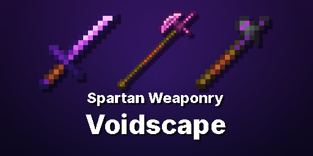

# Spartan Weaponry: Voidscape

A [Spartan Weaponry](https://www.curseforge.com/minecraft/mc-mods/spartan-weaponry) addon for Minecraft 1.20.1 (Forge). It adds every base [Voidscape](https://www.curseforge.com/minecraft/mc-mods/voidscape) gear tier to all 24 Spartan weapon types.

| Tier | Recipe (smithing, Voidic Template) | Traits |
|---|---|---|
| Voidic Crystal | Netherite Spartan weapon + Voidic Crystal | Voidic Damage I, Voidtouched I (+30% in the Void) |
| Corrupt | Voidic weapon + Tendril | Voidic Damage II, Voidtouched II (+40%), Corruption (Wither on hit) |
| Titanite | Corrupt weapon + Purified Titanite Shard | Voidic Damage III, Voidtouched III (+50%), Purge (strips the target's buffs) |
| Ichor | Titanite weapon + Crystallized Ichor | Voidic Damage IV, Voidtouched IV (+60%), Ichor Burn (sets the target on fire) |
| Astral | Ichor weapon + Astral Crystal | Voidic Damage V, Voidtouched V (+75%), Starstruck (glow + slow) |

- **Stats:** Voidscape's own tool tiers.
- **Voidic Damage:** Voidscape's own voidic damage attributes, in the same amounts as its swords and bows.
- **Requires:** Spartan Weaponry, Spartan Weaponry Addon Toolkit, Voidscape.

## Building
- `./gradlew build` (Java 17). Put the dependency jars in `libs/` as `spartanweaponry-3.2.1.jar`, `spartantoolkit-1.6.1.jar` and `voidscape-1.5.389.jar`.
- `python3 tools/gen_assets.py` regenerates every resource, and needs ImageMagick.

## License
MIT. See [LICENSE](LICENSE) and [NOTICE](NOTICE).
